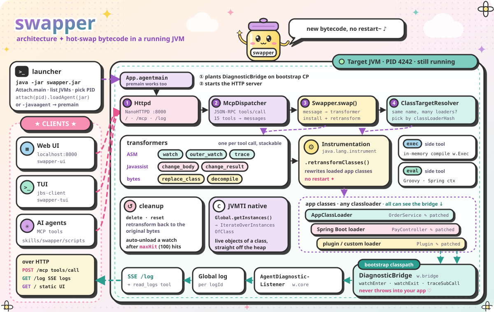

# JVM ByteSwap Tool


A tool that can hot swap the class byte code while jvm is running. Very suitable for `SpringBoot framework`.

Based on the jvm instrumentation tech, ASM, javassist and JVMTI.

<p align="center">
  
</p>

<p align="center">
  <a href="https://nanollm-assets.wuyao.org/jvmbyteswaptool/how-it-works.mp4">
    
  </a>
  <br />
  <sub>▶ Click to watch <b>How swapper works</b> (90s video)</sub>
</p>

# Usage
Download `swapper.jar` from the [release](https://github.com/sunwu51/JVMByteSwapTool/releases) page.

Make sure you have a JDK >= 1.8.
```bash
$ java -jar swapper.jar

// All of the java processes will be listed
// Choose the pid you want to attach
// Then the backend service will start
```

If you want to change the HTTP server port or WebSocket port:
```bash
$ java -jar -Dw_http_port=9999 -Dw_ws_port=19999 swapper.jar
```

## Web UI
After `swapper.jar` starts, visit `http://localhost:8000` and use the Web UI.


Now you can enjoy the functionalities of swapper tool.

For example, `Watch` some methods. Trigger this method, and then the params and return value and execution time cost will be printed. 


It's `Watch` one of the functions provided by swapper tool.

Get more functions and details from the [wiki](https://github.com/sunwu51/JVMByteSwapTool/wiki).

## TUI CLI
You can use the TUI client in the same way as the Web UI.

Install it from npm:
```bash
$ npm i -g jbs-client
$ jbs-client
```

Or download the standalone binary for your platform from the [swapper-tui releases](https://github.com/sunwu51/swapper-tui/releases), then run:
```bash
$ jbs-client
```

The interaction flow is consistent with the Web UI.


